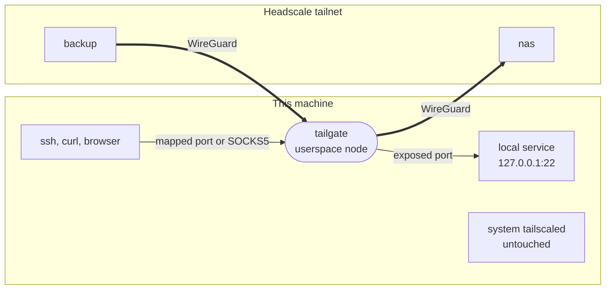

<div align="center">

# 🚪 tailgate

### A whole tailnet node in a single binary

Join a [headscale](https://github.com/juanfont/headscale)/[tailscale](https://tailscale.com) network from userspace and map ports in both directions.<br>
No root, no TUN device, and as many tailnets side by side as you like.


[Quick start](#quick-start) ·
[Going out](#going-out-local--tailnet) ·
[Coming in](#coming-in-tailnet--local) ·
[Reference](#command-reference) ·
[Multiple tailnets](#multiple-tailnets) ·
[RAM mode](#ram-mode-live-state-in-memory-copy-on-disk) ·
[Troubleshooting](#troubleshooting)

</div>

---

**tailgate is a complete Tailscale node that lives inside one process.** No TUN device,
no routes, no firewall rules, no root. It gets its own identity on the tailnet and
hands you plain TCP ports on either side.

Use it as:

- **The only node on a box** where you can't or won't install Tailscale: a NAS with a
  read-only root, a container, a locked-down server, an account without sudo.
- **An extra tailnet** next to the Tailscale you already run. Reach a second network, or a
  third, without logging out, switching profiles, or booting a VM.

```console
$ tailgate serve -control https://headscale.example.com -authkey-file ./authkey &
$ tailgate ssh root@nas                      # straight in, no port juggling
$ tailgate map -p 8443 nas:443               # https://127.0.0.1:8443 now reaches the NAS
$ curl -x socks5h://127.0.0.1:1055 http://backup:8007/
```



## Highlights

| | |
|---|---|
| ➡️ **Outbound** | Map a local port to any tailnet host, or send anything through the built-in SOCKS5 proxy |
| ⬅️ **Inbound** | Expose local ports on the node's tailnet addresses, IPv4 and IPv6, with per-port allow lists |
| 🔑 **One-off SSH** | `tailgate ssh root@host` runs your real `ssh` through the tailnet. Your keys, your config, real `known_hosts` entries |
| 🧾 **Caller log** | Every inbound connection is logged with the peer's node name and tags, because the local service only ever sees `127.0.0.1` |
| 💾 **One SQLite file** | Node keys, server address and mappings in a single `0600` database. Each mapping is persistent or throwaway, your choice |
| 🗂️ **Profiles** | `tailgate -n work …` runs several tailnets side by side, each with its own identity |
| 🧠 **RAM mode** | Keep the live database on tmpfs with a crash-safe copy on a disk that is allowed to disappear |
| 🔒 **Locked-down API** | Control API on localhost TCP, on a Unix socket with file permissions, or switched off |
| 🩺 **Health** | `/health`, `tailgate health` and a status file for dashboards and monitoring |
| 🦕 **Old hardware** | Static `GOAMD64=v1` build runs on CPUs without SSE4.2 or POPCNT |
| 🤫 **Quiet** | Log upload to Tailscale's servers is disabled |

### Why not just…

| | Catch |
|---|---|
| Switch Tailscale profiles | One tailnet at a time. You drop off the first to reach the second |
| A second `tailscaled` | Needs root, a second TUN device, and care with routes and DNS |
| A VM or container | A whole OS to feed and patch, for the sake of a few ports |
| **tailgate** | One unprivileged process per tailnet. All of them up at once |

## Quick start

**You need:** Linux, Go 1.27 or newer, and a pre-auth key from your headscale server.

```sh
git clone https://github.com/JohnConnorNPC/tailgate && cd tailgate
make                      # builds ./tailgate
make install              # ~/.local/bin/tailgate + systemd user units
```

**1. Join the tailnet.** The first run needs the server and a key:

```sh
tailgate serve -control https://headscale.example.com -authkey-file ./authkey
```

Neither is needed again. The node's identity and its server are remembered in the
database. With no key, tailgate prints a login link to open in a browser instead.

**2. Look around:**

```console
$ tailgate status
control: https://headscale.example.com
state:   Running
self:    tailgate.tailnet.internal  100.64.0.5 fd7a:115c:a1e0::5
tags:    tag:gate

PEER                     IP          OS     ONLINE  TAGS
backup.tailnet.internal  100.64.0.9  linux  yes     tag:backup
nas.tailnet.internal     100.64.0.8  linux  yes     tag:server
```

**3. Keep it running:**

```sh
systemctl --user enable --now tailgate
loginctl enable-linger $USER      # optional: keep it up while you're logged out
```

> [!TIP]
> Use a **reusable, non-ephemeral** pre-auth key. Headscale deletes ephemeral nodes while
> they are offline, so the node would come back with a new address after every reboot.

## Going out: local → tailnet

```sh
tailgate map 8022 nas:22           # 127.0.0.1:8022 -> nas:22, gone when the daemon stops
tailgate map -p 8022 nas:22        # -p = persistent, restored on every start
tailgate map -p nas:5432           # random local port, kept stable across restarts
tailgate map 0.0.0.0:8080 nas:80   # bind all interfaces to share with your LAN

ssh -p 8022 root@127.0.0.1
```

Targets can be MagicDNS names, short or full, or tailnet IPs.

**SOCKS5** for everything else, on `127.0.0.1:1055`:

```sh
curl --proxy socks5h://127.0.0.1:1055 http://nas:8080/
```

### One-off SSH

```sh
tailgate ssh root@nas                    # port 22
tailgate ssh root@nas:2222 uptime        # any port, trailing command as usual
tailgate ssh -i ~/.ssh/nas_key -A -L 8080:localhost:80 root@nas
```

This runs your system `ssh` with a `ProxyCommand`, so keys, agent and `~/.ssh/config`
all work, and every ssh option passes straight through. Nothing is mapped and nothing
is left behind.

To make plain `ssh`, `scp`, `rsync` and `sftp` use the tailnet too:

```sshconfig
Host nas backup *.tailnet.internal
    ProxyCommand tailgate nc %h %p
```

`tailgate nc HOST PORT` is the raw building block: stdin and stdout wired to a tailnet host.

## Coming in: tailnet → local

```sh
tailgate serve -expose 22 -expose 443=127.0.0.1:8443@tag:backup,tag:admin
```

```text
-expose PORT[=TARGET][@ALLOW,...]      repeatable
```

- **`TARGET`** defaults to `127.0.0.1:PORT`. A bare port means that port on `127.0.0.1`.
- **`ALLOW`** is optional. Entries can be `tag:NAME`, a node name, a user login (`alice@`),
  an IP, or a CIDR. Your headscale ACL still decides who can connect at all. This is a second gate.
- Exposes given as flags are recreated on every start and can't be changed through the API,
  which suits machines with a read-only root.
- Add one at runtime with `tailgate expose [-p] [-allow LIST] PORT[=TARGET]`.

Every connection is logged with who it really was:

```text
in #6 tailnet:22 <- 100.64.0.9:51234 backup.tailnet.internal [tag:backup] -> 127.0.0.1:22
in #6 tailnet:22 <- 100.64.0.9:51234 closed after 12m3s (rx 4.1MiB, tx 312.0KiB)
in #7 tailnet:443 <- 100.64.0.12:40112 laptop.tailnet.internal user=alice@: REJECTED (allow=tag:backup,tag:admin)
```

```console
$ tailgate ls
ID  DIR  LISTEN          TARGET          ALLOW                 PERSIST  ACTIVE  TOTAL  REJECTED  ERROR
6   in   tailnet:22      127.0.0.1:22    -                     flag     1       14     0
7   in   tailnet:443     127.0.0.1:8443  tag:backup,tag:admin  flag     0       3      1
10  out  127.0.0.1:8443  nas:443         -                     yes      0       2      0
```

## Multiple tailnets

Give each tailnet a profile name. A profile has its own data dir, its own identity and its
own API socket, all derived from the name, so there are no ports to remember.

```sh
tailgate -n work serve -control https://headscale.work.example -authkey-file ./work.key
tailgate -n home serve -control https://headscale.home.example -authkey-file ./home.key
```

```console
$ tailgate -n work ssh root@build-box
$ tailgate -n home map -p 8443 nas:443
$ tailgate profiles
PROFILE    RUNNING  DIR
(default)  yes      ~/.local/share/tailgate
home       yes      ~/.local/share/tailgate-home
work       yes      ~/.local/share/tailgate-work
```

`-n` goes before the command. `export TAILGATE_PROFILE=work` does the same for a whole shell.
Without either you get the default profile, which is the only one with TCP defaults
(`127.0.0.1:7070` for the API, `127.0.0.1:1055` for SOCKS). Named profiles use a Unix socket
for the API and have SOCKS off until you pick a port with `-socks`.

As services, one per profile:

```sh
systemctl --user enable --now tailgate@work
```

```sh
# ~/.config/tailgate/work.env (optional)
TAILGATE_CONTROL=https://headscale.work.example    # first run only
TS_AUTHKEY=...                                     # first run only
TAILGATE_ARGS=-socks 127.0.0.1:1056 -expose 22
```

## Command reference

| Command | What it does |
|---|---|
| `tailgate serve [flags]` | Run the node |
| `tailgate map [-p] [LISTEN] HOST:PORT` | Local port → tailnet host |
| `tailgate expose [-p] [-allow LIST] PORT[=TARGET]` | Tailnet port → local address |
| `tailgate ls` | List mappings with live connection counts |
| `tailgate rm ID...` | Remove mappings |
| `tailgate persist ID [on\|off]` | Make an existing mapping persistent, or not |
| `tailgate status` | This node and the peers it can see |
| `tailgate health` | One line, exit status 0 when up |
| `tailgate ssh [ssh opts] [user@]host[:port] [cmd]` | One-off SSH through the tailnet |
| `tailgate nc HOST PORT` | Raw tunnel on stdin/stdout |
| `tailgate profiles` | List the profiles on this machine |
| `tailgate -n NAME <command>` | Run any command against profile `NAME` |

<details>
<summary><b><code>serve</code> flags</b></summary>
<br>

| Flag | Default | |
|---|---|---|
| `-control URL` | `$TAILGATE_CONTROL` | Your headscale server. Needed on the first run, remembered afterwards |
| `-hostname NAME` | `$TAILGATE_HOSTNAME`, else `tailgate` | Node name on the tailnet |
| `-authkey-file F` | | Pre-auth key for the first login. `$TS_AUTHKEY` also works |
| `-dir DIR` | `~/.local/share/tailgate[-NAME]` | Live database and lock. May be tmpfs with `-state-copy` |
| `-api ADDR` | `127.0.0.1:7070`, or a socket for named profiles | `HOST:PORT`, a Unix socket (`/path` or `unix:path`), or `""` to disable |
| `-api-mode MODE` | `0600` | File mode of a Unix-socket API |
| `-socks ADDR` | `127.0.0.1:1055`, or off for named profiles | SOCKS5 proxy, `""` to disable |
| `-expose SPEC` | | Expose a port on the tailnet, repeatable |
| `-state-copy PATH` | | Keep a consistent copy of the database here |
| `-state-copy-wait DUR` | `0` | At start, wait this long for the copy's folder to appear |
| `-status-file PATH` | | Keep a JSON health file here |
| `-dial-timeout DUR` | `15s` | Timeout for reaching a mapping's target |
| `-v` | | Verbose tailscale logs |

The client commands find the daemon through `-api` or `$TAILGATE_API`, using the same syntax.

</details>

<details>
<summary><b>Files</b></summary>
<br>

| Path | |
|---|---|
| `<dir>/tailgate.db` | Everything: node keys, server address, mappings. Mode `0600`. Back this up and you have the node |
| `<dir>/lock` | Stops two daemons sharing one identity |
| `$XDG_RUNTIME_DIR/tailgate-NAME.sock` | API socket of a named profile (`<dir>/api.sock` without a runtime dir) |
| `~/.config/systemd/user/tailgate.service`, `tailgate@.service` | Installed by `make install` |

</details>

## Control API

Plain JSON over HTTP, on whatever `-api` points at. The CLI is a thin client for it.

```text
GET     /health          up or down, tailnet addresses; 503 when down
GET     /status          this node and its peers
GET     /mappings
POST    /mappings        {"dir":"out","listen":"8022","target":"nas:22","persistent":true}
POST    /mappings        {"dir":"in","listen":"22","target":"127.0.0.1:22","allow":"tag:backup"}
PATCH   /mappings/{id}   {"persistent":false}
DELETE  /mappings/{id}
CONNECT host:port        one-shot tunnel, used by tailgate nc and tailgate ssh
```

```console
$ curl -s --unix-socket /run/tailgate.sock http://tailgate/health
{"up":true,"state":"Running","name":"tailgate.tailnet.internal","ip4":"100.64.0.5",
 "ip6":"fd7a:115c:a1e0::5","tags":["tag:gate"],"peers_online":2,"pid":4242}

$ tailgate health
up Running 100.64.0.5 fd7a:115c:a1e0::5
```

`-status-file PATH` keeps the same JSON in a file, rewritten when it changes and set to
`"state":"Stopped"` on exit.

> [!WARNING]
> The default API is an unauthenticated port on `127.0.0.1`. Any local process can add
> mappings. On shared machines use a Unix socket (`-api /run/tailgate.sock`) or turn it off (`-api ""`).

## RAM mode: live state in memory, copy on disk

For machines whose only writable disk can be unmounted at any time, such as a NAS with a
read-only root and its data on the arrays. tailgate never holds a file open on that disk,
so unmounting it doesn't mean stopping tailgate and cutting off your own SSH session.

```sh
tailgate serve \
  -dir /run/tailgate \
  -state-copy /state/tailgate/tailgate.db -state-copy-wait 2m \
  -authkey-file /state/tailgate/authkey \
  -hostname nas -api /run/tailgate.sock -socks "" \
  -status-file /run/tailgate.status \
  -expose 22 -expose 443
```

| When | What happens |
|---|---|
| Start, `-dir` is empty | The copy is loaded. Same identity, same address, no key needed |
| State or a persistent mapping changes | A consistent snapshot is written: `VACUUM INTO` a temp file, fsync, rename |
| Nothing changes | Nothing is written. An idle node leaves the disks alone |
| Copy's folder is missing or read-only | The save is skipped, shown in `health`, and retried every 30 s. tailgate keeps running |
| Started without the copy, and it appears later | It is **never overwritten**. Restart tailgate to load it |

## Headscale side

tailgate only sees peers, and only accepts connections, that your headscale policy allows.
`tailgate status` shows the node's tags and what it can see.

```jsonc
// let tailgate reach things
{ "action": "accept", "src": ["tag:gate"], "dst": ["tag:server:*"] }

// let others reach the ports tailgate exposes
{ "action": "accept", "src": ["tag:backup", "group:admins"], "dst": ["tag:gate:22,443"] }
```

**Tailscale's own service?** tailgate is built on Tailscale's official `tsnet` library and
nothing in it is headscale-specific, so `-control https://controlplane.tailscale.com` with a
`tskey-auth-…` key should work. It has only been tested against headscale.

## Troubleshooting

<details>
<summary><b><code>no peers visible</code></b></summary>
<br>

The policy grants this node's tags nothing, or the rule's destination matches no real node.
Fix the ACL on the headscale server. tailgate picks up the change by itself.
</details>

<details>
<summary><b>A host is listed but everything times out</b></summary>
<br>

Check the `ONLINE` column in `tailgate status`. If it says `no`, the other node has lost its
connection to headscale and nothing on this side will help. If it says `yes`, the policy
probably doesn't allow that port.
</details>

<details>
<summary><b>The node's address changes after a reboot</b></summary>
<br>

It was registered with an ephemeral key, or its state was lost. Use a non-ephemeral key and,
on diskless setups, `-state-copy`.
</details>

<details>
<summary><b>Traffic to a LAN address isn't going through the tailnet</b></summary>
<br>

Correct. Addresses that aren't on the tailnet are dialed over your normal network. Use the
host's tailnet name or address.
</details>

<details>
<summary><b><code>another tailgate is already running</code></b></summary>
<br>

One daemon per data dir, by design. Two daemons sharing one node key would fight over the
identity, so never point two data dirs at copies of the same database either.
</details>

<details>
<summary><b><code>no headscale server</code></b></summary>
<br>

A fresh data dir doesn't know which server to join. Pass `-control https://…` once, or set
`$TAILGATE_CONTROL`.
</details>

## Limits

- **TCP only** for mappings and exposes.
- **No subnet routers or exit nodes.** tailgate reaches tailnet nodes directly, nothing behind them.
- **Linux.** The Makefile targets `linux/amd64`; other Unix targets may build with plain `go build` but are untested.
- **One identity per profile.** A second tailnet means a second daemon: see [Multiple tailnets](#multiple-tailnets).

## How it works

- **[`tsnet`](https://pkg.go.dev/tailscale.com/tsnet)** embeds a full Tailscale node. Packets go through gVisor's
  userspace network stack instead of a kernel TUN device, which is why no root is needed and the system
  `tailscaled` never notices.
- **SQLite** through the pure-Go [`modernc.org/sqlite`](https://pkg.go.dev/modernc.org/sqlite), so the binary stays
  static. The Tailscale state store is a table in the same file as the mappings.
- **Trimmed build.** The Makefile compiles Tailscale with only the features tsnet needs
  (`.buildtags`; regenerate with `make tags` after upgrading).

```sh
make            # CGO_ENABLED=0 GOOS=linux GOARCH=amd64 GOAMD64=v1
go test ./...
```

The `v1` target was checked by booting the binary under QEMU with a Core 2 CPU model, which has no
SSE4.1, SSE4.2, POPCNT or AES-NI.

---

<div align="center">
<sub>Built by <a href="https://github.com/JohnConnorNPC">JohnConnorNPC</a></sub>
</div>
