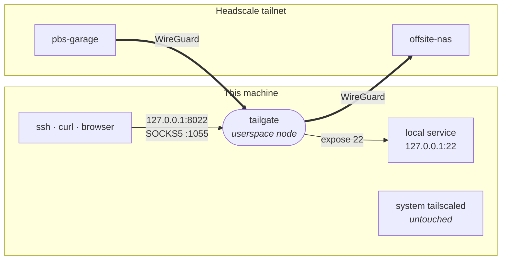

<div align="center">

# 🚪 tailgate

**A second tailnet in a single binary.**
Join a [headscale](https://github.com/juanfont/headscale) network from userspace and map ports in both directions,
without touching the Tailscale you already have installed.


</div>

---

Your machine is already on one tailnet. You need to reach another one, a headscale
network, and you don't want to log out, switch profiles, or run a VM to do it.

`tailgate` is a complete Tailscale node that lives inside one process. No TUN device,
no routes, no firewall rules, no root. It gets its own identity on the headscale
network and gives you plain TCP ports on either side.



## Highlights

| | |
|---|---|
| ➡️ **Outbound** | Map a local port to any tailnet host, or use the built-in SOCKS5 proxy for everything |
| ⬅️ **Inbound** | Expose local ports on the node's tailnet addresses (IPv4 + IPv6), with per-port allow lists |
| 🔑 **One-off SSH** | `tailgate ssh root@host` runs your real `ssh` through the tailnet. No port mapping, real `known_hosts` entries |
| 🧾 **Caller log** | Every inbound connection is logged with the peer's node name and tags, since the local service only sees `127.0.0.1` |
| 💾 **One SQLite file** | Node keys and mappings in a single `0600` database. Mappings are persistent or throwaway, your choice |
| 🧠 **RAM mode** | Run the live database on tmpfs with a crash-safe copy on a disk that is allowed to disappear |
| 🔒 **Locked-down API** | Control API on localhost TCP, a Unix socket with file permissions, or switched off |
| 🩺 **Health** | `/health`, `tailgate health` and a status file for dashboards |
| 🦕 **Old hardware** | Static `GOAMD64=v1` build runs on CPUs without SSE4.2 or POPCNT |
| 🤫 **Private** | Log upload to Tailscale's servers is disabled |

## Quick start

```sh
make                      # builds ./tailgate
make install              # ~/.local/bin/tailgate + systemd user unit

# first run: join with a headscale pre-auth key
tailgate serve -control https://headscale.example.com -authkey-file ./authkey
```

After the first login neither the key nor `-control` is needed again. The node's identity and its server live in the database.

```console
$ tailgate status
control: https://headscale.example.com
state:   Running
self:    tailgate.tailnet.internal  100.64.0.5 fd7a:115c:a1e0::5
tags:    tag:client,tag:gate

PEER                          IP           OS     ONLINE  TAGS
offsite-nas.tailnet.internal  100.64.0.10  linux  yes     tag:nas,tag:server
pbs-garage.tailnet.internal   100.64.0.9   linux  yes     tag:nas-access
```

Run it for good:

```sh
systemctl --user enable --now tailgate
```

> [!TIP]
> Use a **reusable, non-ephemeral** pre-auth key. Headscale deletes ephemeral nodes while
> they are offline, so the node would come back with a new address after every reboot.

## Going out: local → tailnet

```sh
tailgate map 8022 offsite-nas:22        # 127.0.0.1:8022 -> offsite-nas:22, gone when the daemon stops
tailgate map -p 8022 offsite-nas:22     # -p = persistent, restored on every start
tailgate map -p offsite-nas:5432        # random local port, kept stable across restarts
tailgate map 0.0.0.0:8080 web:80        # bind all interfaces to share with your LAN

ssh -p 8022 root@127.0.0.1
```

Targets can be MagicDNS names, short or full, or tailnet IPs.

**SOCKS5** for anything else, on `127.0.0.1:1055`:

```sh
curl --proxy socks5h://127.0.0.1:1055 http://offsite-nas:8080/
```

### One-off SSH

```sh
tailgate ssh root@offsite-nas                 # port 22
tailgate ssh root@offsite-nas:2222 uptime     # any port, trailing command as usual
tailgate ssh -i ~/.ssh/nas_key -A -L 8080:localhost:80 root@offsite-nas
```

This runs your system `ssh` with a `ProxyCommand`, so keys, agent, and `~/.ssh/config`
all work, and every ssh option passes straight through. To make plain `ssh`, `scp`,
`rsync` and `sftp` use it too:

```ssh-config
Host offsite-nas pbs-garage *.tailnet.internal
    ProxyCommand tailgate nc %h %p
```

`tailgate nc HOST PORT` is the raw building block: stdin and stdout wired to a tailnet host.

## Coming in: tailnet → local

```sh
tailgate serve -expose 22 -expose 443=127.0.0.1:8443@tag:pbs,tag:admin
```

```
-expose PORT[=TARGET][@ALLOW,...]      repeatable
```

- `TARGET` defaults to `127.0.0.1:PORT`. A bare port means that port on `127.0.0.1`.
- `ALLOW` is optional. Entries can be `tag:NAME`, a node name, a user login (`alice@`), an IP, or a CIDR.
  Your headscale ACL still decides who can connect at all. This is a second gate.
- Exposes given as flags are recreated on every start and can't be changed through the API,
  which suits machines with a read-only root.
- Add one at runtime with `tailgate expose [-p] [-allow LIST] PORT[=TARGET]`.

Every connection is logged with who it really was:

```
in #6 tailnet:22 <- 100.64.0.9:51234 pbs-garage.tailnet.internal [tag:nas-access] -> 127.0.0.1:22
in #6 tailnet:22 <- 100.64.0.9:51234 closed after 12m3s (rx 4.1MiB, tx 312.0KiB)
in #7 tailnet:443 <- 100.64.0.12:40112 laptop.tailnet.internal user=alice@: REJECTED (allow=tag:pbs)
```

```console
$ tailgate ls
ID  DIR  LISTEN           TARGET           ALLOW    PERSIST  ACTIVE  TOTAL  REJECTED  ERROR
6   in   tailnet:22       127.0.0.1:22     -        flag     1       14     0
7   in   tailnet:443      127.0.0.1:8443   tag:pbs  flag     0       3      1
10  out  127.0.0.1:18443  offsite-nas:443  -        yes      0       2      0
```

## Command reference

| Command | What it does |
|---|---|
| `tailgate serve [flags]` | Run the node |
| `tailgate map [-p] [LISTEN] HOST:PORT` | Local port → tailnet host |
| `tailgate expose [-p] [-allow LIST] PORT[=TARGET]` | Tailnet port → local address |
| `tailgate ls` | List mappings with live connection counts |
| `tailgate rm ID...` | Remove mappings |
| `tailgate persist ID [on\|off]` | Make an existing mapping persistent, or not |
| `tailgate status` | This node and the peers it can see |
| `tailgate health` | One line, exit status 0 when up |
| `tailgate ssh [ssh opts] [user@]host[:port] [cmd]` | One-off SSH through the tailnet |
| `tailgate nc HOST PORT` | Raw tunnel on stdin/stdout |

<details>
<summary><b><code>serve</code> flags</b></summary>

| Flag | Default | |
|---|---|---|
| `-control URL` | `$TAILGATE_CONTROL` | Your headscale server. Needed on the first run, remembered in the database afterwards |
| `-hostname NAME` | `$TAILGATE_HOSTNAME`, else `tailgate` | Node name on the tailnet |
| `-authkey-file F` | | Pre-auth key for the first login. `$TS_AUTHKEY` also works |
| `-dir DIR` | `~/.local/share/tailgate` | Live database and lock. May be tmpfs with `-state-copy` |
| `-api ADDR` | `127.0.0.1:7070` | `HOST:PORT`, a Unix socket (`/path` or `unix:path`), or `""` to disable |
| `-api-mode MODE` | `0600` | File mode of a Unix-socket API |
| `-socks ADDR` | `127.0.0.1:1055` | SOCKS5 proxy, `""` to disable |
| `-expose SPEC` | | Expose a port on the tailnet, repeatable |
| `-state-copy PATH` | | Keep a consistent copy of the database here |
| `-state-copy-wait DUR` | `0` | At start, wait this long for the copy's folder to appear |
| `-status-file PATH` | | Keep a JSON health file here |
| `-dial-timeout DUR` | `15s` | Timeout for reaching a mapping's target |
| `-v` | | Verbose tailscale logs |

The client commands find the daemon through `-api` or `$TAILGATE_API`, using the same syntax.

</details>

## Control API

Plain JSON over HTTP, on whatever `-api` points at.

```http
GET    /health          {"up":true,"state":"Running","ip4":"100.64.0.5","ip6":"..."}   503 when down
GET    /status          this node and its peers
GET    /mappings
POST   /mappings        {"dir":"out","listen":"8022","target":"offsite-nas:22","persistent":true}
POST   /mappings        {"dir":"in","listen":"22","target":"127.0.0.1:22","allow":"tag:pbs"}
PATCH  /mappings/{id}   {"persistent":false}
DELETE /mappings/{id}
CONNECT host:port       one-shot tunnel, used by tailgate nc and tailgate ssh
```

```sh
curl --unix-socket /run/tailgate.sock http://tailgate/health
```

> [!WARNING]
> The default API is an unauthenticated port on `127.0.0.1`. Any local process can add
> mappings. On shared machines use a Unix socket (`-api /run/tailgate.sock`) or turn it off (`-api ""`).

## RAM mode: live state in memory, copy on disk

For machines whose only writable disk can be unmounted at any time, such as a NAS with a
read-only root and its data on the arrays. tailgate never holds a file open on that disk,
so unmounting it does not mean stopping tailgate and cutting off your own SSH session.

```sh
tailgate serve \
  -dir /run/tailgate \
  -state-copy /state/tailgate/tailgate.db -state-copy-wait 2m \
  -authkey-file /state/tailgate/authkey \
  -hostname nas -api /run/tailgate.sock -socks "" \
  -status-file /run/tailgate.status \
  -expose 22 -expose 443
```

| When | What happens |
|---|---|
| Start, `-dir` is empty | The copy is loaded. Same identity, same address, no key needed |
| State or a persistent mapping changes | A consistent snapshot is written: `VACUUM INTO` a temp file, fsync, rename |
| Nothing changes | Nothing is written. An idle node leaves the disks alone |
| Copy's folder is missing or read-only | The save is skipped, shown in `health`, and retried every 30 s. tailgate keeps running |
| Started without the copy, and it appears later | It is **never overwritten**. Restart tailgate to load it |

## Headscale side

tailgate only sees peers, and only accepts connections, that your headscale policy allows.
`tailgate status` shows the node's tags and what it can see.

```jsonc
// let tailgate reach things
{ "action": "accept", "src": ["tag:gate"], "dst": ["tag:server:*"] }

// let others reach ports tailgate exposes
{ "action": "accept", "src": ["tag:pbs", "group:admins"], "dst": ["tag:nas:22,443"] }
```

## Troubleshooting

<details>
<summary><b><code>no peers visible</code></b></summary>

The policy grants this node's tags nothing, or the rule's destination matches no real node.
Fix the ACL on the headscale server. tailgate picks up the change by itself within seconds.
</details>

<details>
<summary><b>A host is listed but everything times out</b></summary>

Check the `ONLINE` column in `tailgate status`. If it says `no`, the other node has lost its
connection to headscale and nothing on this side will help.
</details>

<details>
<summary><b>The node's address changes after a reboot</b></summary>

It was registered with an ephemeral key, or its state was lost. Use a non-ephemeral key and,
on diskless setups, `-state-copy`.
</details>

<details>
<summary><b>Traffic to a LAN address isn't going through the tailnet</b></summary>

Correct. Addresses that aren't on the tailnet are dialed over your normal network. tailgate
does not use subnet routers or exit nodes. Use the host's tailnet name or address.
</details>

<details>
<summary><b><code>another tailgate is already running</code></b></summary>

One daemon per data dir, by design. Two daemons sharing one node key would fight over the
identity. Never point two data dirs at copies of the same database either.
</details>

## How it works

- **[`tsnet`](https://pkg.go.dev/tailscale.com/tsnet)** embeds a full Tailscale node. Packets go through gVisor's
  userspace network stack instead of a kernel TUN device, which is why no root is needed and the system
  `tailscaled` never notices.
- **SQLite** through the pure-Go [`modernc.org/sqlite`](https://pkg.go.dev/modernc.org/sqlite), so the binary stays
  static. The Tailscale state store is a table in the same file as the mappings.
- **Trimmed build.** The Makefile compiles Tailscale with only the features tsnet needs
  (`.buildtags`, regenerate with `make tags` after upgrading).

```sh
make            # CGO_ENABLED=0 GOOS=linux GOARCH=amd64 GOAMD64=v1
go test ./...
```

The `v1` target was checked by booting the binary under QEMU with a Core 2 CPU model, which has no
SSE4.1, SSE4.2, POPCNT or AES-NI.

---

<div align="center">
<sub>Built by <a href="https://github.com/JohnConnorNPC">JohnConnorNPC</a></sub>
</div>
